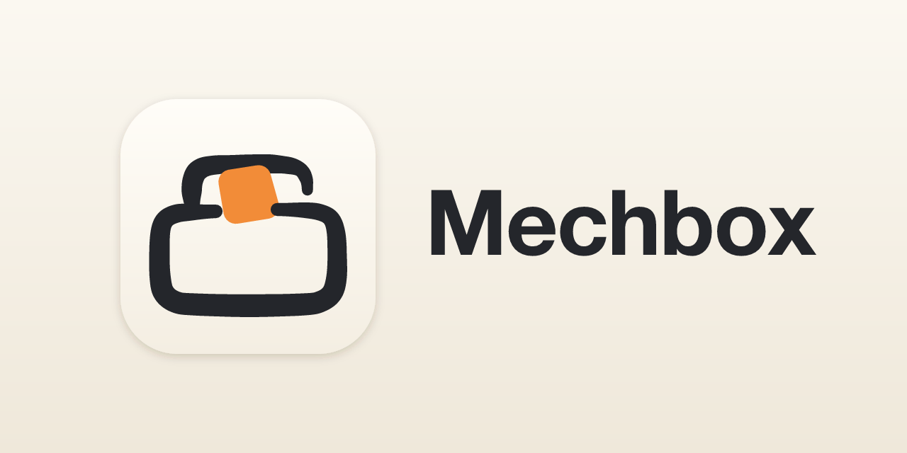

一个 macOS 桌面应用，管理 Claude Code、Codex 等 Agent 用的 [Agent Skills](https://agentskills.io)：从各处收集技能放进自己的库，按需装到全局或某个项目里，来源有新内容时由你审阅后再更新，出了问题可以回滚。

技能是以 `SKILL.md` 为入口的文件夹，Agent 从磁盘上的特定目录发现并按需加载。Mechbox 把库当作唯一权威：Agent 目录里的技能文件夹都由库写出，库不会在你不知情时改动它们。术语见 [CONTEXT.md](CONTEXT.md)。

## 什么时候用

Mechbox 是低频工具，通常在这些时候打开：

- **第一次打开**：你早就用命令行工具或手动拷贝装了一批技能，想让它接过来。
- **要加新技能**：看到别人推荐，或在 skills.sh 上搜到。
- **新项目、新机器**：把常用的技能装过去。
- **Agent 表现怪了**：想知道是不是哪个技能变了，或者退回去。
- **听说作者发了新东西**：去看看来源里有什么新变化。

## 承诺

技能是 Agent 会照着执行的指令和脚本，以你的权限运行。无论哪个功能都守住这几条（[ADR 0010](docs/adr/0010-product-promises.md)）：

- 你什么都没点，Agent 用的内容就不会变。检查更新可以自动进行，但只读。
- 每次更新都能回滚。
- 来源里删掉的技能，不会自己从库里或 Agent 里消失。
- 你明确不要的东西，不会再作为待办出现，除非来源里又有了新变化。
- 你在装出去的文件夹里改过的内容，不会在没有明确说明的情况下被覆盖。

## 安装

从 [GitHub Releases](https://github.com/tiaot33/mechbox/releases) 下载最新版本。

- **macOS 12 及以上**（Apple 芯片与 Intel 通用）：下载 `.dmg`，把 Mechbox 拖进「应用程序」。应用没有经过 Apple 公证，第一次打开前在终端执行 `xattr -dr com.apple.quarantine /Applications/mechbox.app`。
- **Windows**：运行 `-setup.exe`。安装程序没有代码签名，SmartScreen 提示时点「更多信息 → 仍要运行」。
- **Linux**：`.deb`（Ubuntu 24.04+ / Debian 13+）、`.rpm`（Fedora）、`.pkg.tar.zst`（Arch），或给 `.AppImage` 加上可执行权限后直接运行。

Windows 和 Linux 版有些功能还没有，见[尚未支持](#尚未支持)。

## 功能

### 入库

- 一个输入框识别来源：本地目录、GitHub（`owner/repo`、链接或某个子目录的 tree 链接）、GitLab 等 Git 仓库（含 SSH 地址）、`SKILL.md` / zip / tar 下载链接，以及提供 well-known 技能索引的站点。Git 仓库可以选分支或 tag。
- 先做入库预览，列出来源里的候选和未成为候选的原因，勾选后入库。GitHub 仓库可以查看 skills.sh 的安全审计。
- 在应用里搜索 skills.sh 技能市场，直接入库预览。

### 接过已有的技能

- 第一次打开时，认出各 Agent 全局目录里不是库装的技能（未纳管技能）；每登记一个项目，认出项目里的。入库时磁盘上什么都不改，Agent 用的和原来一样。
- 用 `npx skills` 装的技能，从它留下的记录认出来源，入库后跟着来源检查更新；认不出来源的成为没有来源的技能。
- 提交在项目仓库里的、同一个 Agent 的全局和项目里同名的技能都会标出来，并写明同名时在这个 Agent 里会怎样。

### 组织与安装

- 按来源自动形成集合；也可以按场景手动建组。
- 把技能装到作用域：某个 Agent 的全局，或某个 Agent 加一个已登记项目。可以直接安装单个技能，也可以组安装，组里以后加入的技能自动装上。
- 安装前先看安装计划，目标位置已有同名文件夹时询问是否覆盖。
- 支持自定义 Agent 和它读取技能的目录；几个 Agent 共用一个目录时，装一次都算已装。
- 巡检已装的技能是否被手动改过、落后于库里的版本或已缺失，逐处重新安装。在装出去的地方改过的技能，可以用这份修改更新库里的技能。

### 检查更新、更新与回滚

- 按集合检查来源有没有新的来源版本，可以按间隔自动检查（只在打开时、每小时、每天、每周）。要处理的更新数显示在 Dock 角标和左栏，不弹系统通知。
- 更新前看更新计划：先标风险（新增或改动的脚本、新增的可执行文件），再给 GitHub 的提交说明，最后是文件差异。还会列出来源里已删除、可能改名的技能和来源里的新技能。
- 自己选更新哪些技能、重新安装到哪些地方；改过的地方默认不勾。可以跳过某个技能这一次的改动。
- 每次更新、跳过、回滚都留在集合的历史里；任何一次更新都能回滚，库和那次装过的地方一起退回去。
- 每个技能保存全部版本，可以比较任意两个版本、查看旧版文件。

### 同步

- 手动把整个库推送到 S3（或兼容 S3 的服务），在另一台机器上拉回，再把各个已登记项目对应到这台机器上的位置。推送或拉回前先看同步计划：S3 上是哪台机器、什么时候推送的那一份。

## 数据存在哪里

所有内容都在 `~/Library/Application Support/mechbox/library.db` 里，这是一个 SQLite 数据库：

- 库：技能、版本、集合、组、安装记录、已登记项目。
- 设置页里的设置：GitHub 令牌、检查更新、菜单栏、Dock 角标、语言、显示哪些 Agent，以及 S3 同步设置。

设置只认数据库里的，不读环境变量，也不存在系统钥匙串里（[ADR 0011](docs/adr/0011-settings-live-in-the-database.md)）。同步时，库和大部分设置随推送、拉回走；S3 同步设置和 WSL 发行版只属于这台机器，推送时不带，拉回时保留本机的。

应用开着时不要只复制 `library.db` 来备份，尚未合并的写入还在旁边的 `library.db-wal` 里；要备份就用同步推送，或退出应用后再复制。

GitHub 令牌没填时匿名访问 GitHub API，受限时再试本机 `gh` 的登录。同步要在设置页填好存储桶、Access Key ID 和 Secret Access Key；对象名默认 `library.db`，区域默认 `us-east-1`，服务地址留空时用 AWS S3。

## 尚未支持

- 系统通知：有更新时只显示 Dock 角标和左栏计数。
- Windows、Linux：有安装包，但没有一等支持。没有 Dock 角标；「在 Finder 中显示」不起作用；卸载 Mechbox 时只删技能库（设置都在里面），应用本身和 WebView 的数据还在，要用系统的方式卸载。

## 开发

从源码构建、调试和打包见 [`cmd/desktop/README.md`](cmd/desktop/README.md)；代码结构与约定见 [AGENTS.md](AGENTS.md)，设计决策见 [`docs/adr/`](docs/adr/)。

## 致谢

Agent 图标来自这两个项目：

- [agentlogos.dev](https://agentlogos.dev)：大多数 Agent 的彩色图标。
- [LobeHub Icons](https://github.com/lobehub/lobe-icons)（MIT 许可）：agentlogos.dev 没有的 Agent 图标，以及 Claude Code、Gemini CLI、Kiro、Amp 的图标。按名字认出 Agent 用的关键词表也是照它的 agentConfig 写的。

图标里的 logo 是各自所有者的商标。
