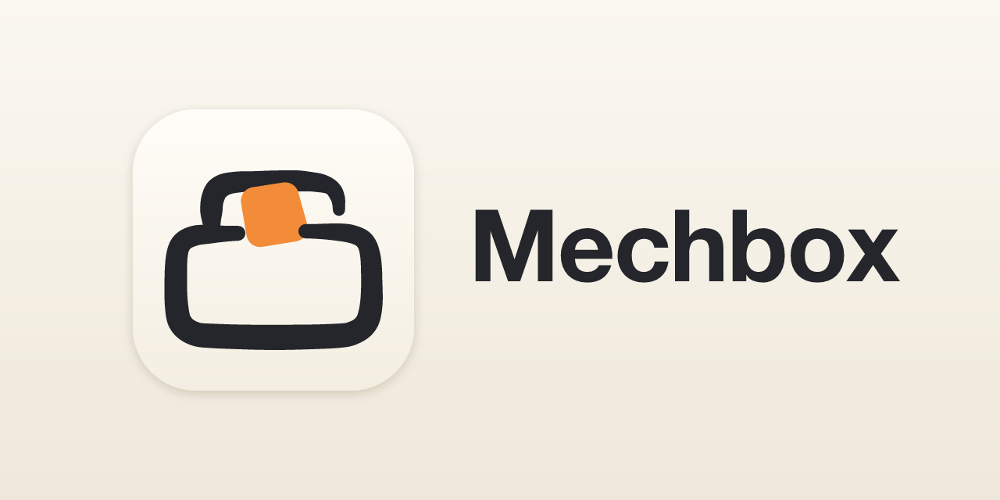

**Mechbox** 是一个管理 [Agent Skills](https://agentskills.io) 的桌面应用（支持 Claude Code、Codex 等编码 Agent）：先从各处把技能收进本机的**库**，再按需装到全局或各个项目里；来源有变化时由你审阅后再更新，出了问题可以回滚。

> **当前状态**：早期迭代中（`v0.0.x`）。macOS 12+ 为一等支持；Windows 与 Linux 提供安装包，但部分功能尚未补齐（见[当前状态与平台限制](#当前状态与平台限制)）。安装包暂未做 Apple 公证或代码签名。

## 为什么做 Mechbox（产品定位）

如果你已经用命令行工具或手动拷贝装过技能，可能会问：为什么还要多装一个桌面应用？

- **不是又一个往目录里直接写文件的 CLI，而是你本机的技能库。** 直接把技能装进各个 Agent 目录，同一个技能会拆散在多处：看不出哪份旧了、哪份改过，换项目换机器也带不走。Mechbox 把**入库**和**安装**拆成两步：本机 SQLite 库是唯一权威，技能按来源自动聚成集合、按场景手动建组，装在哪些作用域、版本历史和本地改动都在一处看清。
- **把技能当作供应链来管。** 技能是以 `SKILL.md` 为入口的文件夹，里面可能带着 Agent 会以你的权限执行的指令和脚本。Mechbox 的定位是**低频安全网**——你每天打开的是 Agent，不是它。平时它在后台只读检查更新、不弹系统通知打扰；需要动手时，先标出新增或改动的脚本与可执行文件，再给提交说明和逐行差异，每次更新都能连同已安装的地方一起回滚。

### 五条底线承诺

无论做什么功能，都守住这五条：

1. **你没点头，Agent 用的技能就不变。** 检查更新可以自动进行，但只读，绝不静默改文件。
2. **每次更新都能回滚。** 库和那次更新重新安装过的地方一起回到旧版。
3. **远程来源里删掉的技能，不会自己消失。** 库只标出来，要不要移除由你决定。
4. **你明确不要的东西，不再作为待办打扰你**（除非来源里又有了新变化）。
5. **你在装出去的文件夹里改过的内容，不会在没有明确说明的情况下被覆盖。**

### 什么时候打开它

- **第一次打开**：把你早就用命令行工具或手动拷贝装好的技能接过来，磁盘上一个字节都不改。
- **要加新技能**：在一个输入框里粘贴 GitHub、GitLab、本地目录、下载链接或 well-known 站点，或在应用内搜索 skills.sh。
- **新项目、新机器**：整组把常用技能装到新项目，或经 S3 备份把整套库带到另一台机器。
- **Agent 表现怪了**：看清它在这个项目里实际看到了哪些技能（含未纳管技能、同名谁生效、最近哪天变过），不对就回滚。
- **听说作者发了新版**：审阅更新计划后决定更新哪些技能、同步到哪些作用域。

## 快速开始

### 1. 安装

从 [GitHub Releases](https://github.com/tiaot33/mechbox/releases) 下载最新版本：

- **macOS 12+（Apple 芯片 / Intel 通用）**：打开 `.dmg`，把 Mechbox 拖进「应用程序」。因未经过 Apple 公证，首次打开前在终端执行：
  ```sh
  xattr -dr com.apple.quarantine /Applications/mechbox.app
  ```
- **Windows**：运行 `-setup.exe`。安装程序没有代码签名，SmartScreen 提示时点「更多信息 → 仍要运行」。
- **Linux**：安装 `.deb`（Ubuntu 24.04+ / Debian 13+）、`.rpm`（Fedora）、`.pkg.tar.zst`（Arch），或给 `.AppImage` 加上可执行权限后直接运行。

### 2. 上手三步

1. **接管已有技能，或入库第一个新技能**：第一次打开时，Mechbox 会自动列出各 Agent 全局目录里已有的技能，一次确认即可接管（磁盘文件原样不动；项目里的技能在登记项目时再接）。如果电脑里还没有技能，点顶栏「技能市场」搜一个，或点「入库技能」输入 GitHub 仓库（如 `owner/repo`），在入库预览里勾选入库。
2. **安装到 Agent**：选中技能或组，装到目标作用域（某个 Agent 的全局，或某个 Agent 加一个已登记项目）。看过安装计划并确认后，技能文件夹会写入对应目录。
3. **审阅更新与排查**：来源有新版时，左栏和 Dock 会显示待处理计数。打开更新计划看风险与差异再决定是否更新；在 Agent 目录里顺手改了技能，也可以用这份修改更新库并同步给其他 Agent。

## 主要能力

- **接管已有技能**：从 `npx skills` 留下的记录认出来源（接管后继续跟踪作者更新），标出已提交进项目 git 仓库、登记在项目 `skills-lock.json` 里或指向 Agent 目录以外的符号链接（默认不接）；按作用域列全已纳管与未纳管技能，并写明同名时在该 Agent 里的生效结果。详见[已有技能的产品逻辑](docs/product/existing-skills.md)与 [ADR 0014](docs/adr/0014-existing-skills-recognized-by-content.md)。
- **多来源入库**：一个输入框识别本地目录、GitHub（`owner/repo`、仓库或子目录 tree 链接）、GitLab 等 Git 仓库（含 SSH，可选分支或 tag）、`SKILL.md` / zip / tar 下载链接与 well-known 站点；GitHub 仓库可查看 skills.sh 安全审计。
- **组织与多 Agent 安装**：按来源自动形成集合，按场景手动建组；支持组安装（后续入组技能自动装上）、自定义 Agent 目录、多 Agent 共用目录去重，以及跨项目 / 跨 Agent 照着装。
- **检查更新、更新与回滚**：可设自动检查更新间隔（仅打开时 / 每小时 / 每天 / 每周）；更新计划依次列出脚本风险、提交说明、逐行差异、可能改名与来源已删除的技能；支持跳过单次改动、对比任意历史版本与整次回滚。详见[更新的产品逻辑](docs/product/update.md)。
- **跨机器 S3 同步**：把整个库推送到 S3 或兼容 S3 的对象存储（每台机器独立目录，只增不覆盖，支持定时自动推送）；拉回始终手动，先看同步计划再确认。详见 [ADR 0013](docs/adr/0013-sync-keeps-backups-per-machine.md)。

<details>
<summary>数据位置、备份与配置参考（SQLite / GitHub 令牌 / S3 权限）</summary>

- **数据位置**：全部技能、版本、集合、组、安装记录、已登记项目与设置都在单个 SQLite 数据库 `~/Library/Application Support/mechbox/library.db` 里。设置只认数据库里的，不读环境变量，也不存在系统钥匙串里（[ADR 0011](docs/adr/0011-settings-live-in-the-database.md)）。
- **手动备份注意**：应用开着时不要只复制 `library.db`，尚未合并的写入还在旁边的 `library.db-wal` 里；请用同步推送，或退出应用后再复制。
- **GitHub 访问**：未填个人访问令牌时匿名访问 GitHub API，受限时再试本机 `gh` 登录。
- **S3 同步配置**：在设置页填好存储桶、Access Key ID 和 Secret Access Key（用到列出、读、写和删除对象权限）；文件夹留空时备份放在存储桶根下，区域默认 `us-east-1`，服务地址留空时用 AWS S3。S3 同步设置与 WSL 发行版只属于本机，推送时不带，拉回时保留本机设置。

</details>

## 当前状态与平台限制

- **系统通知**：尚未支持，有更新时只显示 Dock 角标和左栏计数。
- **Windows / Linux**：有安装包，但没有一等支持——无 Dock 角标；Linux 上「在文件管理器中显示」只打开所在目录、不选中；应用内卸载 Mechbox 只删技能库（设置都在里面），应用本体和 WebView 数据需用系统方式卸载。

## 深入了解与参与开发

- **产品与设计文档**：[产品定位](docs/product/positioning.md) · [更新的产品逻辑](docs/product/update.md) · [已有技能的产品逻辑](docs/product/existing-skills.md) · [术语表](CONTEXT.md) · [设计决策 (`docs/adr/`)](docs/adr/README.md)
- **源码构建与开发**：从源码构建、调试和打包见 [`cmd/desktop/README.md`](cmd/desktop/README.md)；代码结构与约定见 [AGENTS.md](AGENTS.md)。
- **问题反馈与维护**：遇到问题或有建议，请在 [GitHub Issues](https://github.com/tiaot33/mechbox/issues) 反馈。本项目由 [@tiaot33](https://github.com/tiaot33) 维护，基于 [MIT License](LICENSE) 开源。

## 致谢

Agent 图标来自 [agentlogos.dev](https://agentlogos.dev) 与 [LobeHub Icons](https://github.com/lobehub/lobe-icons)（MIT 许可；按名字认出 Agent 的关键词表亦参考其 `agentConfig`）。图标里的 logo 是各自所有者的商标。
