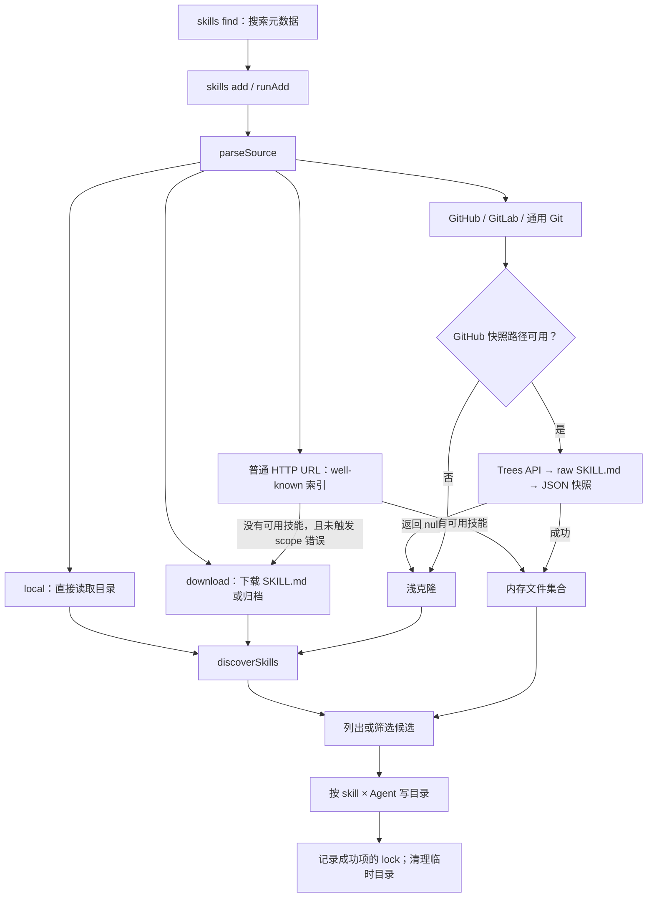

# skills.sh CLI 的 Skill 拉取内部实现

本文用于查阅 skills.sh 配套 CLI `vercel-labs/skills` 的来源解析、内容获取、候选发现及安装后的更新依据。以下均为指定源码快照的行为，不代表线上服务或最新版 CLI 的承诺。

- 核对日期：2026-09-28。
- 本地源码：`/Users/dur/code/github-clone/vercel-labs/skills`，核对时工作区无修改。
- 版本：`skills@1.5.26`，commit [`d667282815248da03a08a18272b5d2eef9caf77c`](https://github.com/vercel-labs/skills/tree/d667282815248da03a08a18272b5d2eef9caf77c)。下文源码链接均固定到该 commit。
- 背景：延续「对比 skills.sh 工具与现有 Skill 拉取」对话的源码调查，重新核对实现；旧对话中本项目的接口描述不作为当前规格。
- 验证范围：静态阅读源码，未运行对方测试、真实远端下载或 Agent 目录安装。

Skill 格式与客户端发现规则见 [Agent Skills 背景](agent-skills-background.md)；本项目领域边界见 [CONTEXT.md](../../CONTEXT.md) 和 [ADR 0004](../adr/0004-sources-are-typed.md)。本文记录外部实现，不引入本项目的新架构决策。

## 1. 总体调用链

`runAdd` 把获取内容、选择技能、选择 Agent、写入目录及更新 lock 串在一个命令中。内容获取既可能产生临时磁盘目录，也可能直接产生内存中的文件集合。[主入口 `src/add.ts:1104`][add]

`--list` 在候选发现后退出，不执行安装；但此时可能已经克隆仓库或下载全部候选的快照。`--skill` 通常是在发现后筛选，不能笼统视为只下载一个目录。

## 2. 搜索只返回来源与名称

`searchSkillsAPI` 请求 `${SKILLS_API_URL || 'https://skills.sh'}/api/search?q=...&limit=20`，可附加 `owner`。读取 `skills[]` 的 `id/name/source/installs`，清理展示文本，按安装量降序排列；请求或解析失败返回空列表。[`src/find.ts:87`][find]

交互选择结果后，以 `source || slug` 为来源、`name` 为 `--skill` 参数调用同进程的 `runAdd`。搜索响应不包含用于安装的完整文件，也不是 ZIP 下载地址。非交互查询主要输出结果与安装命令，不能把所有 `find` 调用都理解为自动安装。[`src/find.ts:326`][find]

## 3. 来源解析与优先级

`parseSource` 输出 `type/url`，以及可选的 `localPath/ref/subpath/skillFilter`。按匹配顺序分流，托管平台的 raw/archive/release 链接先于普通仓库 URL 识别。[`src/source-parser.ts:272`][parser]

| 输入形态 | 内部结果与后续行为 |
| --- | --- |
| 绝对路径、`./`、`../`、`.`、`..`、Windows 盘符路径 | `local`，解析为绝对路径；主流程检查存在后直接扫描，不克隆 |
| `owner/repo`、`github:owner/repo` | 通常为 `github`，规范成 HTTPS `.git` URL |
| `owner/repo/path/to/skill` | 仓库加 `subpath`；Git 路径仍克隆仓库，再缩小扫描范围 |
| `owner/repo@skill-name` | `skillFilter`，随后并入 `options.skill` |
| Git 来源的 `#ref`、`#ref@skill` | 提取并 URL 解码 ref；简写分支可携带技能过滤；普通网页 fragment 不一概作为 ref |
| GitHub `/tree/<ref>/<path>` | 分离 ref 与 subpath；这里 ref 的正则只取一个路径段，不能据此声称支持含 `/` 的分支名消歧 |
| GitLab `/.../-/tree/<ref>/<path>`、`gitlab:...` | `gitlab`，支持 subgroup；带 `/-/tree/` 的 URL 可识别自托管实例 |
| `raw.githubusercontent.com`，GitHub raw/archive/release，GitLab raw/archive | `download`，直接读取 URL，不先克隆父仓库 |
| 其他符合条件的 HTTP(S) URL | `well-known`；先发现索引，再决定是否直接下载 |
| SSH、其他未匹配的 Git 地址 | `git`，交给 `cloneRepo` |

另外有两个固定别名：`coinbase/agentWallet` → `coinbase/agentic-wallet-skills`，`vercel-labs/vercel-skills` → `vercel-labs/agent-skills`。设置 `GH_HOST` 后，Enterprise 简写及识别出的 Enterprise URL 走通用 Git 路径，避开 GitHub.com 专用快照分支。[`src/source-parser.ts:145`][parser]

`sanitizeSubpath` 拒绝 `..` 路径段；磁盘发现前再用解析后的路径检查其是否仍处于 basePath 内。这些是词法路径检查，不应描述成完整的符号链接隔离。[`src/skills.ts:193`][skills]

## 4. Git 路径：浅克隆与认证回退

`cloneRepo(url, ref)` 在系统临时目录建立 `skills-*`，使用 `simple-git`：[实现 `src/git.ts:296`][git]

1. 无 ref：`git clone --depth 1`，由 Git 使用远端默认分支；有 ref：额外传 `--branch <ref>`。
2. 只有 ref 是完整 40 位十六进制 SHA，且错误属于找不到 branch/ref 时，才清空临时目录并尝试 `git init` → `remote add origin` → `fetch --depth 1 origin <sha>` → `checkout FETCH_HEAD`。先尝试分支/tag，因此不会把同形分支名预先误判为 commit。
3. GitHub HTTPS 认证失败时，尝试现有 `gh` 登录：先运行 `gh auth status`，再 `gh repo clone ... -- --depth=1 [--branch ...]`；仍失败则改为 SSH URL 重试。SSH 路径也有完整 SHA 回退。
4. 超时或最终失败删除临时目录，抛出 `GitCloneError`，区分超时、认证和一般克隆错误。成功目录由调用方用完后清理。

默认超时为 300 秒，可通过 `SKILLS_CLONE_TIMEOUT_MS` 修改。主 Git client 设置 `GIT_TERMINAL_PROMPT=0`，协议白名单为 `https:http:ssh:git:file`，显式拒绝 `ext::`。它继承调用者的 Git/SSH/代理等环境，并禁用 LFS filter、设置 `GIT_LFS_SKIP_SMUDGE=1`；LFS 文件因此可能只是 pointer。独立的 `gh repo clone` 回退没有复制全部 LFS 配置，不能把主 client 的所有选项外推给它。[`src/git.ts:1`、`:161`、`:236`][git]

这是整个仓库工作树的浅克隆，没有 sparse checkout，也没有在普通 Git 路径按所选 skill 单独传输文件。

## 5. GitHub 快照路径：Trees → raw → download

### 5.1 何时尝试

`runAdd` 仅在来源为 `github` 且未开启 `--full-depth` 时考虑快照；还要求 owner 在 `vercel`、`vercel-labs`、`heygen-com`、`remotion-dev` 白名单内，或仓库存在于 `BLOB_ALLOWED_REPOS`。当前额外仓库为 `zapier/connectors`。[`src/add.ts:1332`][add]

即使命中白名单，`tryBlobInstall` 收到显式 ref 时也立即返回 `null`：快照 URL 只有 owner/repo/slug，不绑定 ref。调用方因此转入 Git。[`src/blob.ts:553`][blob]

### 5.2 获取树与发现 SKILL.md

`fetchRepoTree` 调用 GitHub Trees API：`GET /repos/{owner}/{repo}/git/trees/{ref}?recursive=1`。有 ref 时只查询它；无 ref 时依次尝试 `HEAD`、`main`、`master`，每次 HTTP 请求超时 10 秒。[`src/blob.ts:110`、`:235`][blob]

认证策略是匿名优先。遇到 `403 + X-RateLimit-Remaining: 0`，或可能通过认证解决的 `401/404`，才尝试 `GITHUB_TOKEN`、否则 `GH_TOKEN`，之后调用 `gh api` 使用已有登录。普通权限拒绝 `403` 不触发该回退。进程内记录匿名限流状态，后续 tree 查询直接走认证；某仓库的 `404` 不设置全局限流标记。[`src/skill-lock.ts:139`][global-lock]

`findSkillMdPaths` 在返回树中搜索技能路径，应用 subpath、常见容器目录及最多三层容器扫描；没有优先目录结果时才回退到最多五层路径。该实现没有读取 plugin JSON，也没有检查 Trees 响应的 `truncated` 字段。[`src/blob.ts:349`][blob]

### 5.3 下载元数据与文件集合

1. `@skill` 先尝试按目录名的 slug 缩小路径集合；随后并发读取 `https://raw.githubusercontent.com/{owner}/{repo}/{tree.branch}/{path}`。
2. 解析 frontmatter 的 `name/description/metadata`，计算 slug：小写，空白和 `_` 转 `-`，移除其他非 ASCII 字母数字字符，合并并修剪 `-`。
3. 对留下的候选用 `Promise.all` 并发读取 `${SKILLS_DOWNLOAD_URL || 'https://skills.sh'}/api/download/{owner}/{repo}/{slug}`；`zapier/connectors` 改用 `https://connectors-skills.zapier.com/download/{slug}/snapshot.json`。
4. 响应形状为 `{ files: [{ path, contents }], hash }`，内容保存在内存 `BlobSkill.files`，不落成仓库目录。这里的 `contents` 是字符串，未携带文件 mode。
5. 任一已选快照请求失败，或某个嵌套 skill 的可安装文件路径在快照中缺失，返回 `null`，整条路径回退 Git。完整性检查排除 `metadata.json`、`.git`、`__pycache__`、`__pypackages__`。

源码：[`src/blob.ts:442–708`][blob]。两轮并发均直接使用 `Promise.all`，没有额外并发数上限。raw 请求未复用 tree 请求的认证信息。

### 5.4 必须保留的限制

- **根目录 skill 只保留 `SKILL.md`。** 根 skill 跳过嵌套目录完整性检查，随后从快照中移除其他文件；普通磁盘安装会递归复制根目录的辅助文件，两条路径不等价。
- **路径齐全不等于内容一致。** 完整性检查只对照路径集合，没有把快照字节逐文件与 Git blob SHA 比对；Trees、raw 和快照也没有固定到同一个不可变 commit。服务返回的 `hash` 通常直接保存，仅在根 skill 裁剪文件后重新计算。
- **并非任意失败都会自动回退。** 主流程只针对 `null` 回退；例如 raw frontmatter 的 YAML 解析没有逐条 `try/catch`，抛异常会进入命令外层错误处理。raw 读取失败或缺少字段的候选则可能被跳过，只要仍有其他有效候选，就继续快照流程。
- **internal 过滤有分支差异。** 磁盘发现读取 `INSTALL_INTERNAL_SKILLS`；快照解析只检查传入的 `includeInternal`，由显式技能选择设置，没有直接检查该环境变量。

这些限制来自上述函数的实际分支，不能用文件头的“任意失败回退”说明替代代码行为。

## 6. 直接下载：SKILL.md、ZIP、tar、tar.gz

`downloadSource` 创建 `skills-download-*`，先流式下载到 `source.download`，自动跟随重定向；通过 Content-Length 和流式字节计数双重限制大小。[`src/download-source.ts`][download]

| 限制 | 默认值 | 配置 |
| --- | --- | --- |
| HTTP 超时 | 30 秒 | 固定常量 |
| 下载体积 | 10 MiB | `SKILLS_DOWNLOAD_MAX_BYTES` |
| 解压总体积 | 25 MiB | `SKILLS_EXTRACT_MAX_BYTES` |
| 归档条目数量上限 | 1000 | `SKILLS_EXTRACT_MAX_FILES` |

先尝试把内容解析为含字符串 `name/description` 的 Markdown，成功则写成临时 `skill/SKILL.md`。否则按 ZIP/GZIP 文件头识别，或尝试普通 tar。解压后若顶层只有一个目录（忽略 `__MACOSX`），以该目录作为发现根，再调用 `discoverSkills`。空文件、不可解析内容、下载或解压失败会删除临时目录。

ZIP 由自有 `readZipArchive` 解析，支持 ZIP64、stored/deflate，验证边界、CRC、体积及路径；目录条目不加入文件集合，链接等特殊类型及加密条目会被拒绝。tar 使用 `tar.x`，只接收普通文件和目录，跳过其他类型。两者都会拒绝越界路径。ZIP 最终写出的是字节集合，不保存归档中的可执行权限；tar 分支使用 `noChmod: true`，也不应视为完整的权限快照协议。[`src/archive.ts`][archive]

直接下载分支在 `add` 中设置 `directDownload`，不写普通 Git 来源的全局或项目 lock，因此不能依靠这两类 lock 自动更新直接下载项。[`src/add.ts:1981–2129`][add]

## 7. well-known：先取索引，再取技能文件

`WellKnownProvider` 探测 `.well-known/agent-skills/index.json`，再探测旧的 `.well-known/skills/index.json`。每种路径先尝试用户 URL 的相对位置，再尝试站点根位置；整组索引请求共用 10 秒的 timeout signal。[`src/providers/wellknown.ts:184`][wellknown]

索引有两种内容模型：

| 模型 | 获取方式 | 完整性与失败行为 |
| --- | --- | --- |
| legacy / v0.1.0：`name/description/files[]` | 先取 `<index-base>/<name>/SKILL.md`，再并发取其余 files | 辅助文件失败会被忽略，技能可能只有部分文件；辅助内容按字节保存 |
| v0.2.0：`$schema` 与 `name/type/url/digest` | 下载 `skill-md` 或 `archive` artifact | 先验证整个 artifact 的 `sha256:<hex>`，不匹配返回 null；归档需要根 `SKILL.md`，支持 ZIP/tar.gz，解包上限 50 MiB、1000 文件 |

`fetchAllSkills` 并发获取一个索引下的候选，过滤失败项与 internal 技能，返回首个有可用结果的候选索引。对带路径的 URL，只接受路径范围内的结果：若该范围没有技能而站点根索引存在，抛 `WellKnownScopeNotFoundError`，主流程终止，避免扩大为整个站点目录。[`src/providers/wellknown.ts:451–658`][wellknown]

完全没有可用索引结果时，`handleWellKnownSkills` 返回 `false`，主流程尝试直接下载原 URL。有结果时走独立的选择与 `installWellKnownSkillForAgent` 安装流程。该 provider 的 artifact/file 请求没有统一复用上一节的 30 秒、10 MiB 下载限制。[`src/add.ts:630`][add]

## 8. 磁盘候选发现：目录顺序、元数据与去重

本地目录、克隆目录和解压目录共用 `discoverSkills(basePath, subpath, options)`。[`src/skills.ts:200`][skills]

1. 读取 basePath 下的 `skills-lock.json`，用于识别 Agent 目录中已安装的项目技能；搜索范围由 subpath 决定。
2. 若搜索根存在有效 `SKILL.md`，且不是 lock 跟踪的已安装副本，加入候选；未设置 `--full-depth` 时直接返回。
3. 顺序扫描搜索根、`skills`、`skills/.curated`、`skills/.experimental`、`skills/.system`，以及 `.agents/skills`、`.claude/skills`、`.codex/skills` 等代码列出的 Agent 容器。
4. 搜索根只查一层子目录，常见容器最多深入三层；发现含 `SKILL.md` 的子目录后停止继续向该子目录深入，即使该文件解析后无效。递归时跳过 `node_modules/.git/dist/build/__pycache__`。
5. 加入 plugin manifest 声明的搜索目录。只有优先扫描完全没有结果，或指定 `--full-depth`，才执行最多五层的递归扫描；`full-depth` 仍有深度上限。

`parseSkillMd` 使用 `yaml` 解析 `---` frontmatter，要求 `name/description` 为真值字符串；不是对开放格式全部约束的严格校验。读取错误、YAML 错误或必填字段无效时警告并跳过该候选。保留 `path/rawContent/metadata`，清理用于展示的名称和描述。[`src/frontmatter.ts`][frontmatter]、[`src/skills.ts:97`][skills]

默认按解析后的 `name` 去重，先发现者保留，名称比较区分大小写；更新流程可用 `includeDuplicateNames` 保留重复以识别歧义。最终 `filterSkills` 则对名称作大小写不敏感的精确匹配，没有通用模糊匹配。

`metadata.internal === true` 默认隐藏；显式 `--skill name` / `@name` 或 `INSTALL_INTERNAL_SKILLS=1/true` 可包含它，`--skill '*'` 本身不算显式点名。Agent 目录中的候选若名称或目录名与项目 lock 对应，会被视为已安装副本而排除，避免二次发布。

### Plugin manifest 如何参与

读取搜索根的 `.claude-plugin/marketplace.json` 与 `.claude-plugin/plugin.json`。支持 `metadata.pluginRoot`、本地 `plugins[].source`、`skills[]`；路径须符合 `./` 形式并处于 basePath 内。远端 source 对象不递归拉取。[`src/plugin-manifest.ts`][plugins]

显式 skill 路径会转为父目录加入扫描，同时加入惯例 `skills/` 目录。因此它提供的是发现线索，不是严格的文件或候选 allowlist。独立的 `getPluginGroupings` 根据显式路径附加 `pluginName`，用于候选展示分组。

## 9. 写目录、lock 与后续再拉取

### 安装边界

`runAdd` 按所选 skill × 安装目标逐项调用 installer 并收集结果，允许部分成功；lock 写入失败被捕获，不撤销已安装目录。主流程在 `finally` 清理临时内容。它没有跨全部目标的事务提交或持久版本历史。[`src/add.ts:1919`、`:2299`][add]

常规 symlink 模式先写 `.agents/skills/<name>`，再向 Agent 专属位置建链接；copy 模式直接复制到 Agent 目录，链接失败可回退复制。全局 canonical 目录通常是 `~/.agents/skills`；Agent、项目根是否存在和 Eve 等特例会改变目标行为。[`src/installer.ts:295`][installer]

磁盘 `copyDirectory` 递归保留辅助文件，排除 `.git/__pycache__/__pypackages__` 和 `metadata.json`；对符号链接使用 dereference，跳过失效链接，并按源 stat 设置文件权限。blob installer 则按字符串文件列表写 UTF-8，不恢复原始可执行位。[`src/installer.ts:500`、`:1015`][installer]

### 两类 lock 的哈希不同

| 记录 | 内容与作用 |
| --- | --- |
| 全局 v3 lock | 默认 `~/.agents/.skill-lock.json`；设 `XDG_STATE_HOME` 时改用 `$XDG_STATE_HOME/skills/.skill-lock.json`。记录 source、sourceUrl、sourceType、ref、skillPath、skillFolderHash 等。GitHub 优先取 skill 目录 tree SHA，根 skill 取仓库根 tree SHA；拿不到 tree 时安装流程可改用本地内容哈希 |
| 项目 v1 lock | 项目 `skills-lock.json`，记录 source、可选 sourceUrl/ref/skillPath、computedHash 等。磁盘内容按相对路径排序，把路径和文件字节依次送入 SHA-256；排除 `.git/node_modules`，不纳入 mode。blob 则使用快照 hash |

全局 GitHub 安装会复用一份仓库 tree 计算多项 hash；well-known 另有 digest 和来源地址字段。lock 里的 branch/tag 仍可能移动，不能将这些记录等同于不可变内容快照。[`src/add.ts:2050`][add]、[`src/skill-lock.ts`][global-lock]、[`src/local-lock.ts:145`][local-lock]

### 更新如何复用拉取能力

全局 `updateGlobalSkills` 按 **source + ref** 分组；GitHub 先取一次 tree 比较目录 SHA。API 不可用或已锁定路径缺失时，每组克隆一次，并以 `fullDepth + includeDuplicateNames` 重新发现，处理路径迁移、歧义和删除，再计算对应 Git tree hash 或内容 hash。[`src/update.ts:489`][update]

真正更新通过 `spawnSync(process.execPath, [cliEntry, 'add', ...])` 重入本地 CLI，保留 ref、技能名与安装范围；没有通过 shell 或嵌套 `npx` 执行。检查阶段共享一次 clone，不代表重新安装阶段复用它。[`src/update.ts:680`][update]

项目 `updateProjectSkills` 也按 source + ref 分组克隆，以解析路径和删除情况，然后逐项重新 `add`；它的刷新流程不是与全局相同的“先比 GitHub tree SHA，仅更新变化项”。well-known 则按来源地址分组，通过专门的 digest 比较流程处理。[`src/update.ts:336`、`:739`][update]

## 10. 附加网络请求与本项目使用边界

主 GitHub `add` 在解析来源后并行查询仓库公开性。只有明确为公开仓库时，才启动所选技能的安全审计查询；该快照中的 CLI 使用 `https://add-skill.vercel.sh/audit`，默认超时 3 秒，失败不阻止安装。该接口与本项目另行调研的 skills.sh v1 审计 API 分开看待。[`src/add.ts:1544`][add]、[`src/telemetry.ts:110`][telemetry]；另见 [skills.sh 安全审计接口](../research/skills-sh-audit.md)。

借鉴此实现时，优先取其来源解析、候选优先扫描、下载分流、source + ref 分组和认证回退机制。具体适配仍遵循本项目 `PreviewFetch → Fetch → Install`、SQLite 权威和独立安装边界；调用整个 `skills add` 会同时带入目录写入、Agent 选择和 lock 管理。快照是否适用，还需单独解决 commit 绑定、完整文件、二进制与 mode 的语义，不能仅以下载成功判定与 Git 路径等价。

[add]: https://github.com/vercel-labs/skills/blob/d667282815248da03a08a18272b5d2eef9caf77c/src/add.ts
[find]: https://github.com/vercel-labs/skills/blob/d667282815248da03a08a18272b5d2eef9caf77c/src/find.ts
[parser]: https://github.com/vercel-labs/skills/blob/d667282815248da03a08a18272b5d2eef9caf77c/src/source-parser.ts
[git]: https://github.com/vercel-labs/skills/blob/d667282815248da03a08a18272b5d2eef9caf77c/src/git.ts
[blob]: https://github.com/vercel-labs/skills/blob/d667282815248da03a08a18272b5d2eef9caf77c/src/blob.ts
[download]: https://github.com/vercel-labs/skills/blob/d667282815248da03a08a18272b5d2eef9caf77c/src/download-source.ts
[archive]: https://github.com/vercel-labs/skills/blob/d667282815248da03a08a18272b5d2eef9caf77c/src/archive.ts
[wellknown]: https://github.com/vercel-labs/skills/blob/d667282815248da03a08a18272b5d2eef9caf77c/src/providers/wellknown.ts
[skills]: https://github.com/vercel-labs/skills/blob/d667282815248da03a08a18272b5d2eef9caf77c/src/skills.ts
[frontmatter]: https://github.com/vercel-labs/skills/blob/d667282815248da03a08a18272b5d2eef9caf77c/src/frontmatter.ts
[plugins]: https://github.com/vercel-labs/skills/blob/d667282815248da03a08a18272b5d2eef9caf77c/src/plugin-manifest.ts
[installer]: https://github.com/vercel-labs/skills/blob/d667282815248da03a08a18272b5d2eef9caf77c/src/installer.ts
[global-lock]: https://github.com/vercel-labs/skills/blob/d667282815248da03a08a18272b5d2eef9caf77c/src/skill-lock.ts
[local-lock]: https://github.com/vercel-labs/skills/blob/d667282815248da03a08a18272b5d2eef9caf77c/src/local-lock.ts
[update]: https://github.com/vercel-labs/skills/blob/d667282815248da03a08a18272b5d2eef9caf77c/src/update.ts
[telemetry]: https://github.com/vercel-labs/skills/blob/d667282815248da03a08a18272b5d2eef9caf77c/src/telemetry.ts
